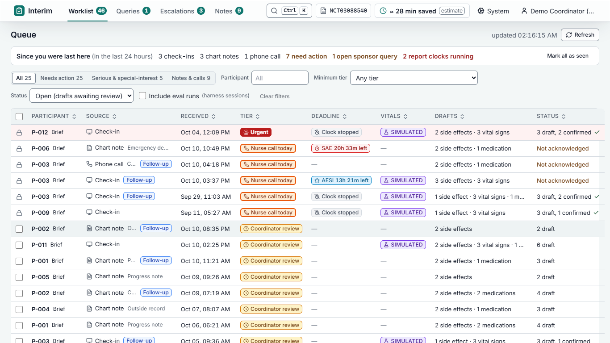
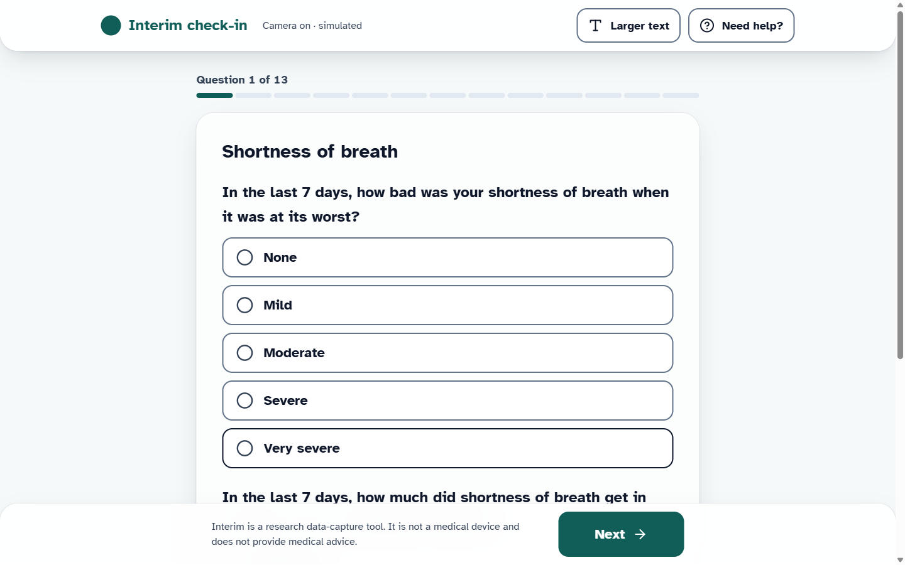
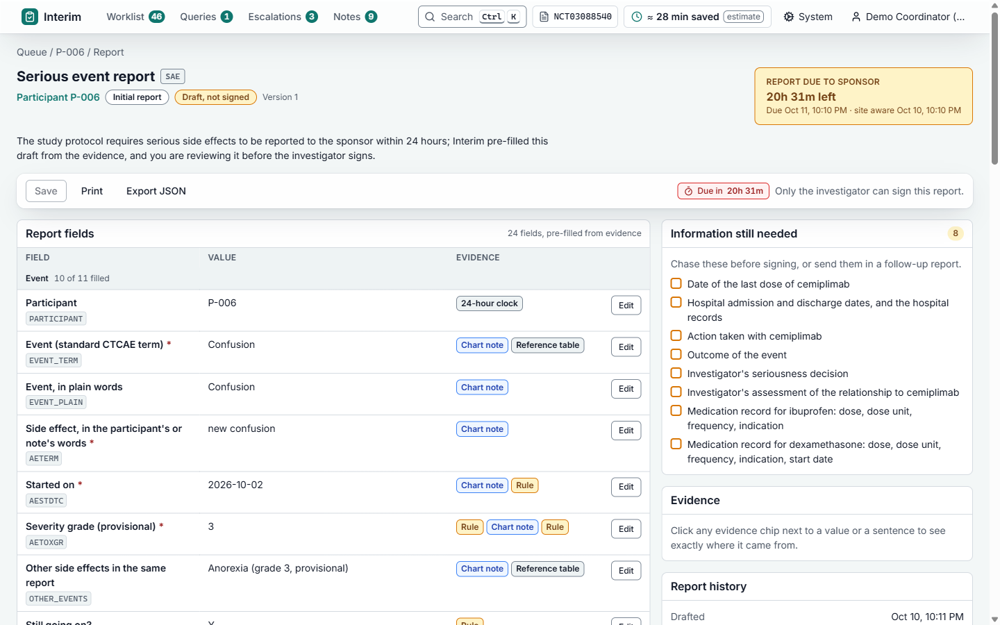
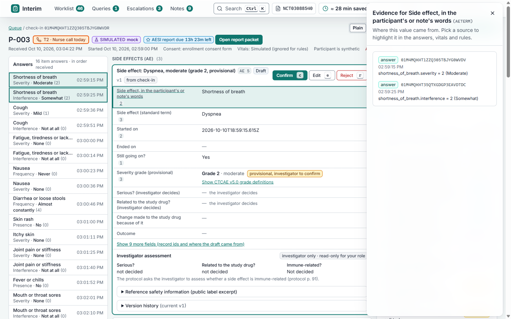
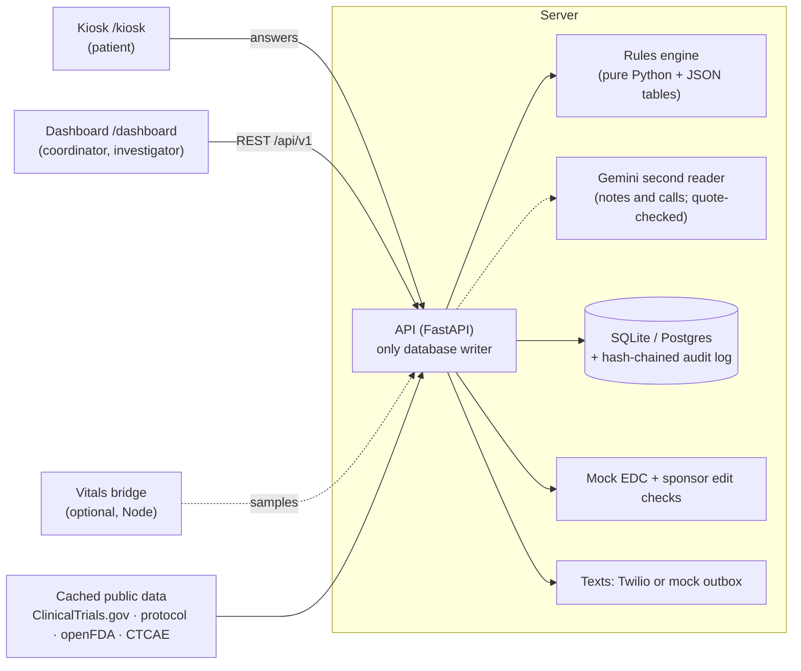

# Interim: the trial coordinator's safety-data desk

[](https://github.com/omer-khawar/ae-checkin-agent/actions/workflows/ci.yml) · MIT · `docker compose up --build` · HackRU Fall 2026, Regeneron "Best Clinical Trials Solution"

**Live demo: (https://interim-web-pjx6.onrender.com/)** · patient kiosk at `/kiosk` · dashboard at `/login` (pick any role, password `interim-demo`) · if it's been idle, the first load takes about a minute while the free server wakes up, and the demo data resets to its starting state.

**Patients in cancer trials get side effects between visits. Interim catches them as soon as they're mentioned, at a check-in, in a hospital note or on a phone call. It hands the study coordinator ready-to-confirm records and 24-hour reports, with every field linked to the exact words it came from.**

> **Rules decide, Gemini reads, people confirm.** Nothing is accepted without a word-for-word quote, and nothing leaves the system without a human click.



<sub>Captured from the running app. Every participant is synthetic. The demo study is a real, public Regeneron trial record: EMPOWER-Lung 1 (NCT03088540), cemiplimab (LIBTAYO) in non-small cell lung cancer.</sub>

> Interim is a research data-capture tool. It is not a medical device and does not give medical advice. That sentence is in the footer of every screen.

---

## The problem, in plain words

A clinical trial only works if the team writes down every side effect a patient has. The person who does that is the **study coordinator**, and the system they work in is leaky:

- **Side effects get missed.** In one study of cancer trials, doctors failed to record **40.7–74.4%** of the symptoms patients themselves reported (Di Maio et al., *J Clin Oncol*, 2015). Patients forget by the next visit, and things said on a phone call or written in an ER note often never reach the trial record.
- **Serious events start a 24-hour clock.** When a trial patient is hospitalized, or has a side effect the protocol flags as special, the site has to report it to the sponsor within 24 hours (EMPOWER-Lung 1 protocol §9.4.2–9.4.3; 21 CFR 312.64(b)). Today a coordinator assembles that report by hand from several systems.
- **Coordinators spend their week retyping.** Sites report about **12–15 hours per study per week** copying data from the hospital chart into the trial database (vendor-reported, Mednet). Two-thirds of sites say they're short on coordinators (Advarra, 2025).

Tracking symptoms closely isn't paperwork for its own sake. In a randomized trial of 766 patients, weekly symptom monitoring raised median survival from 26.0 to 31.2 months (Basch et al., *JAMA*, 2017).

**Interim's goal is to give coordinators that time back without letting anything slip.**

---

## What Interim does: catch, pre-fill, confirm

| | What happens | Who does it |
|---|---|---|
| **1. Catch** | The patient answers a short check-in at the clinic kiosk: one question per screen, plain words, "in the last 7 days". The coordinator pastes in an outside chart note (urgent care, ER, clinic) or logs a phone call. | Patient, coordinator |
| **2. Read and decide** | A rules engine scores the answers (PRO-CTCAE), sets a **provisional** grade (CTCAE) and an urgency tier, checks the trial's own protocol (special-interest events, banned or discouraged medications), and starts a 24-hour clock if needed. For notes and calls, a deterministic scanner and **Gemini** both read the text, and every finding must quote the note word for word. | Software |
| **3. Pre-fill** | Trial-database records (CDISC SDTM: AE, CM, VS), a 24-hour report packet with a drafted narrative, a suggested answer to sponsor questions, and a one-page brief before the next visit. Every field and every sentence links to its evidence. | Software |
| **4. Confirm** | The coordinator confirms, edits or rejects each record. Only the investigator (the trial doctor) can decide seriousness and causality, and sign a report. Every action goes into a tamper-evident audit log. | People |

### The screens

| Step in the life of a side effect | Screen |
|---|---|
| Patient checks in between visits | **Kiosk** `/kiosk` |
| A note or phone call comes in | **Notes** `/dashboard/notes` (paste a note, or "Log a call") |
| Coordinator finds what needs attention | **Worklist** `/dashboard`: one queue for every source, sorted by urgency, with 24-hour clock countdowns and repeat reports merged |
| Coordinator checks and confirms records | **Check-in / note detail**: click any field to see the words or answer it came from |
| Serious or special-interest event, report due in 24 h | **Report packet** `/dashboard/packets/:id`: pre-filled, lists what's missing, investigator signs |
| Sponsor sends a question about a record | **Queries** `/dashboard/queries`: suggested answer with evidence |
| Investigator needs a briefing before the visit | **Visit brief** `/dashboard/participants/:usubjid/brief`: one printable page |
| Proving nothing was changed after the fact | **Audit** `/dashboard/audit`: hash-chained log, one-click verify |
| "What happens if I change the input?" | **Eval** `/dashboard/eval`: run any test persona or build your own |

| Kiosk question | Report packet | Evidence behind a field |
|---|---|---|
|  |  |  |

---

## What's in the final build

These were added on hackathon day, after a playtest as a patient, a coordinator and a judge ([`docs/CONTRACTS.md`](docs/CONTRACTS.md) R5–R6):

- **Urgent symptoms come first.** The first kiosk question is "Right now, are you having trouble breathing, or chest pain or tightness?" A Yes, or severe shortness of breath at any point, stops the check-in right away. The patient sees a fixed screen with 911 and the site phone, the team is alerted, and the visit is marked urgent.
- **Free text is read, not just stored.** "Anything else?" answers are scanned for emergency phrases ("can't catch his breath", "chest feels tight") and for requests to talk to a person.
- **Several medications at once.** "Add another medication", and "cephalexin and hydrocortisone cream" becomes two records instead of one.
- **Gemini second reader** for chart notes and call summaries (details below). It finds things the keyword scanner can't, like "Hypothyroidism, grade 2, likely immune-related".
- **Confirmation texts to the patient.** After a check-in, the patient gets a plain-language text: what time it was received, the site phone, and "call 911 in an emergency". For urgent check-ins it adds "the study team will call you today", and the patient gets a second text when the coordinator reviews it. Real SMS through Twilio when keys are set; otherwise texts go to a mock outbox (**Admin → Outbox**).
- **Accessibility:** read aloud (browser speech), a real "Larger text" mode, camera off by default, Yes always before No.

### How Gemini is used, and how it's kept honest

```
note or call ──► deterministic scanner ─┐
            └──► Gemini (structured JSON) ──► quote check ──► merge (add only) ──► rules grade it ──► coordinator confirms
```

- Gemini lists possible side effects and medication changes, each with a **quote** copied from the note. It is told not to grade, diagnose or judge seriousness.
- `interim_rules/llm_verify.py` keeps a finding only if the quote really appears in the note and the term is in a fixed vocabulary. Everything else is dropped and shown as "rejected".
- Gemini can only **add** findings. It never removes the scanner's findings and never sets a grade, tier, seriousness or causality. Those stay in the rules engine.
- Called over the Google Generative Language REST API with `httpx` (no SDK), temperature 0, with a timeout, *before* the database write so a slow reply can't block the app.
- **Works without a key:** answers for the demo notes are cached in `data/llm_cache/gemini_reader.json`. With no key and no cached answer, it runs on rules only.
- Measured on a 2-case smoke test: the scanner alone found 2 of 3 expected side effects; with Gemini, 3 of 3, with 0 negated terms wrongly kept ([`docs/eval/reader_results.md`](docs/eval/reader_results.md)). That's a smoke test, not an accuracy estimate.

---

## Try it

### Run it with Docker (recommended)

```bash
git clone https://github.com/omer-khawar/ae-checkin-agent.git interim
cd interim
docker compose up --build
```

| What | Where |
|---|---|
| Dashboard (log in here) | http://localhost:5173/ |
| Patient kiosk | http://localhost:5173/kiosk |
| API docs (OpenAPI) | http://localhost:8000/docs |

The API seeds the demo data on first start. `docker compose down -v` wipes it, and the next `up` re-seeds. Ports bind to `127.0.0.1` because the demo password is public.

**Logins:** pick a role on the login page. The shared password is `interim-demo`, set with `DEMO_PASSWORD`.

| Role | Can |
|---|---|
| `coordinator` | Confirm, edit and reject records; acknowledge escalations; prepare report packets; answer queries; log calls; export |
| `investigator` | Everything a coordinator can, plus decide seriousness, causality and immune-related, and **sign** reports. Only this role can. |
| `admin` | Everything, plus settings, the text outbox, demo reset, and the sponsor side of queries |

### Deploy to Render

`render.yaml` is a one-click Blueprint: **New + → Blueprint →** pick this repo, enter a `DEMO_PASSWORD`, deploy. It creates `interim-api` (Docker) and `interim-web` (static site, `/api/*` proxied to the API). Optionally add `GEMINI_API_KEY` to `interim-api`. On the free plan the API sleeps when idle and re-seeds when it wakes. See [`deploy/README.md`](deploy/README.md).

### Local development

```bash
cp .env.example .env     # optional; nothing needs editing for the demo
make install             # Python 3.12 venv + editable installs + npm ci (needs Node 20+)
make dev                 # API :8000, web :5173, mock vitals bridge :8787
```

Also: `make test`, `make lint`, `make eval` (replays every answer key against a fresh API; must be 100%), `make demo-reset`. Each has an `npm run` twin in [`package.json`](package.json).

Windows without `make` (Git Bash):

```bash
py -3.12 -m venv .venv
.venv/Scripts/python.exe -m pip install -e "packages/rules[dev]" -e "apps/api[dev]"
npm run install:all
npm run dev
```

### What the demo data shows ("Monday morning")

It's 8 am, and overnight:

- **Three kiosk check-ins.** One is diarrhea "almost constantly", a grade 3 on a possibly immune-related symptom, so a 24-hour special-interest clock starts. Another reports **prednisone started**, which the protocol discourages, so it's flagged with the protocol's exception text.
- **A caregiver phone call** about a patient's breathing.
- **An urgent-care note**, merged into that patient's open rash.
- **An ER admission note**, which starts a 24-hour serious-event clock with its report pre-filled.

Also seeded: one sponsor query open and one answered, a follow-up report due, a visit tomorrow with its brief ready, and 12 synthetic participants with Synthea-based histories. The 3-minute walkthrough is in [`docs/DEMO.md`](docs/DEMO.md).

---

## Tech stack

| Layer | Technology | What it does |
|---|---|---|
| **Web app** | React 18, TypeScript, Vite, Tailwind, React Router, Recharts; served by nginx | The kiosk and the dashboard, as one single-page app. It holds no data of its own and only talks to the API. |
| **API** | Python 3.12, FastAPI, Pydantic, Uvicorn | The system of record. It checks the user's role on every request, is the **only** thing that writes to the database, and returns RFC 7807 errors. |
| **Rules engine** | Pure Python package `interim_rules`, with every clinical number in JSON tables with sources | Scoring, grading, urgency tiers, protocol rules, chart-note scanner, medication matcher, de-duplication, SDTM drafting, template writer, time model. No I/O, `mypy --strict`, ≥ 95% branch coverage. |
| **AI reader** | Gemini (Flash) over the REST API with `httpx`; committed cache | Second reader of notes and calls. Adds only quote-verified findings. |
| **Database** | SQLite through SQLModel (Postgres by changing `DATABASE_URL`) | Check-ins, records and their versions, packets, queries, messages, and a **hash-chained audit log** (each entry fingerprints the one before it, and `GET /audit/verify` finds any break). |
| **Notifications** | Twilio REST, or a mock outbox | Patient confirmation texts. |
| **Vitals bridge** (optional) | Node 20, TypeScript, `ws` | Streams pulse and breathing from a mock, Presage SmartSpectra or Arduino source. Labeled SIMULATED or MEASURED, and it never changes a grade. |
| **Build and ship** | GitHub Actions CI, Docker multi-stage images, Docker Compose, Render Blueprint, Kubernetes (Kustomize) + Argo CD + Jenkinsfile | Every push runs lint, type checks, tests, the eval and a Docker build. |



| Folder | What's in it |
|---|---|
| [`apps/web`](apps/web/README.md) | Kiosk and dashboard |
| [`apps/api`](apps/api/README.md) | FastAPI service, Gemini reader (`interim_api/readers/`), notifier, seed |
| [`packages/rules`](packages/rules/README.md) | The rules engine and its JSON tables |
| [`apps/vitals-bridge`](apps/vitals-bridge/README.md) | Optional vitals sources ([`docs/VITALS_SOURCES.md`](docs/VITALS_SOURCES.md)) |
| [`scripts`](scripts) | Public-data fetch, seed, eval harness, Synthea import |
| [`deploy`](deploy/README.md) | Render, Kubernetes, Argo CD, Jenkins |
| [`legacy`](legacy/README.md) | The original AE Capture Desk prototype, kept for lineage |

---

## Evaluation

Everything below is reproducible from a clean clone (`make eval`, `python scripts/eval_reader.py --check`, `python scripts/synthea/eval_synthea.py --check`).

**Regression suite, replayed over HTTP against the running API** ([`docs/eval/results.md`](docs/eval/results.md)):

- **36 / 36** check-in personas pass. Tier precision and recall are 1.00 for every tier.
- **7 / 7** final-build kiosk personas pass: the urgent early stop, free text read, and several medications in one box.
- **3 / 3** counterfactuals pass: same answers with one setting changed, and the tier moves while no grade does.
- **42 / 42** fully scorable chart-note scanner cases are exact, and **8 / 8** notes pass through `POST /notes`.

These answer keys were written alongside the rules. So 100% means "the rules do what the tables say," not "the rules are clinically right."

**Independent test on Synthea notes the scanner was never tuned on** ([`docs/eval/synthea_results.md`](docs/eval/synthea_results.md)):

- Symptoms: precision 0.919, recall 0.792.
- Medications named in text: precision 1.000, recall 0.178.

These weak spots are why the Gemini second reader exists, and why a person confirms everything.

---

## Measured vs. simulated

| Thing | Status | How it's labeled |
|---|---|---|
| Participants, check-ins, notes, calls, phone numbers | **Synthetic** (phone numbers in the fictional 555-01xx range) | "All participants are synthetic" in the header |
| Participant backgrounds | **Synthea synthetic EHR** | That label wherever it appears |
| Study record, protocol rules, LIBTAYO label, CTCAE terms | **Real public sources**, cached | Protocol page number on every protocol rule |
| Grades and special-interest flags | **Provisional** | "(provisional, investigator to confirm)" |
| Vitals | **Simulated** in the demo | SIMULATED next to every value; never changes a grade |
| Time saved | **Estimate** | "estimate" next to the number, assumptions on hover |
| EDC posting and sponsor reporting | **Mock** | "reported (mock)"; nothing is sent anywhere real |

---

## Data sources

| Source | Used for |
|---|---|
| [ClinicalTrials.gov API v2, NCT03088540](https://clinicaltrials.gov/study/NCT03088540) | The demo study (EMPOWER-Lung 1, Regeneron) |
| [EMPOWER-Lung 1 protocol, Amendment 9](https://cdn.clinicaltrials.gov/large-docs/40/NCT03088540/Prot_000.pdf) | 24-hour SAE reporting (§9.4.2), special-interest events (§9.4.3), banned and discouraged medications (§7.7), with page numbers and sha256 |
| [openFDA drug label API](https://open.fda.gov/apis/drug/label/) | LIBTAYO adverse-reactions excerpt; the bundled medication list (not RxNorm) |
| [NCI CTCAE v5.0](https://evs.nci.nih.gov/ftp1/CTCAE/CTCAE_5.0/) | Standard term names and grade text |
| [NCI PRO-CTCAE](https://healthcaredelivery.cancer.gov/pro-ctcae/) | Structure of the check-in questions (our wording is modeled on it, not the licensed items) |
| [Basch et al. 2021, *Clin Trials*](https://doi.org/10.1177/1740774520975120) | PRO-CTCAE composite scoring tables |
| [Synthea](https://github.com/synthetichealth/synthea) (MITRE) | 12 synthetic lung-cancer charts and 72 notes, imported offline |
| [CDISC SDTM IG](https://www.cdisc.org/standards/foundational/sdtmig) | AE / VS / CM variable names |

Public data is fetched only by `scripts/fetch_public.py` and committed, so the app runs offline. The only runtime network calls are optional: Gemini (with a key), Twilio (with keys) and the Presage SDK.

---

## Readiness

- **Runs from a clean clone** with `docker compose up --build`, or `make dev` / `npm run dev`.
- **CI on every push:** ruff, mypy `--strict`, pytest (95% branch-coverage gate on the rules), eslint, `tsc`, web and bridge tests, the offline data check, the Synthea reproducibility check, the deterministic eval, and a Docker build.
- **Configuration only through environment variables**, all documented in [`.env.example`](.env.example). No secrets in the repo.
- **Roles are enforced server-side** on every endpoint, and only the investigator signs. The audit log is append-only and hash-chained.
- **No telemetry**, no third-party scripts, and a health endpoint at `GET /api/v1/health`.
- **Deployment paths:** Render Blueprint, plus Kubernetes manifests, an Argo CD Application and a Jenkinsfile. The manifests render in CI but haven't been applied to a live cluster.
- **MIT license.**

**What production would still need:** single sign-on with per-user audit identity; 21 CFR Part 11 electronic signatures; Postgres and TLS; real EDC (e.g. Medidata Rave) and safety-database connectors in place of the mock; FHIR intake from the hospital EHR in place of pasted notes; and licensed PRO-CTCAE, MedDRA and RxNorm. See [`docs/PRD.md`](docs/PRD.md) §10–11.

---

## What it gets wrong

- The PRO-CTCAE → CTCAE grade mapping is our approximation, not a validated crosswalk.
- The keyword scanner finds only what its lexicon names, and it over-flags templated text.
- The Gemini reader is measured only on a 2-case smoke test.
- The time-saved figure is an estimate built mostly on labeled assumptions.
- The Presage vitals source has never run against a live camera.

The full list, with reproducible examples, is in [`docs/WHAT_IT_GETS_WRONG.md`](docs/WHAT_IT_GETS_WRONG.md). What we chose not to build is in [`docs/NOT_BUILT.md`](docs/NOT_BUILT.md).

## Documentation

| Document | What it is |
|---|---|
| [`docs/PRD.md`](docs/PRD.md) | Product requirements, user stories, success metrics, mapping to the starter sheet |
| [`docs/DEMO.md`](docs/DEMO.md) | 3-minute demo script with exact clicks |
| [`docs/CONTRACTS.md`](docs/CONTRACTS.md) | Interface contracts (R5: urgent path, free text, Gemini; R6: confirmation texts) |
| [`docs/DECISIONS.md`](docs/DECISIONS.md) | Decision log |
| [`docs/ISSUES.md`](docs/ISSUES.md) | Issue tracker |
| [`docs/SLIDES.md`](docs/SLIDES.md) | Deck outline with speaker notes |
| [`data/synthetic/README.md`](data/synthetic/README.md) | How the synthetic data is generated |
| [`docs/screenshots/v3/`](docs/screenshots/README.md) | Screenshots of the current build |
| [`CLAUDE.md`](CLAUDE.md) | The original build brief (read §00 first) |

---

## Team

- **Omer Khawar**, Rutgers Computer Engineering. He wrote the original AE Capture Desk (deterministic chart-note scanner, answer key, Presage groundwork), which was ported into Interim ([`docs/DECISIONS.md`](docs/DECISIONS.md) D-014).
- **Rian Patel**

Built for Regeneron's starter sheet 08, *"How Are You Feeling?"* ([`site-sheet-08-how-are-you-feeling.md`](site-sheet-08-how-are-you-feeling.md)), at HackRU Fall 2026.

**Credits:** Synthea, © The MITRE Corporation, Apache-2.0 (Walonoski et al., *JAMIA* 2018). Presage Technologies' SmartSpectra SDK (an optional install, never bundled). Google Gemini API. NCI (PRO-CTCAE, CTCAE), Basch et al., ClinicalTrials.gov, openFDA and CDISC.

## License

MIT. See [`LICENSE`](LICENSE).
