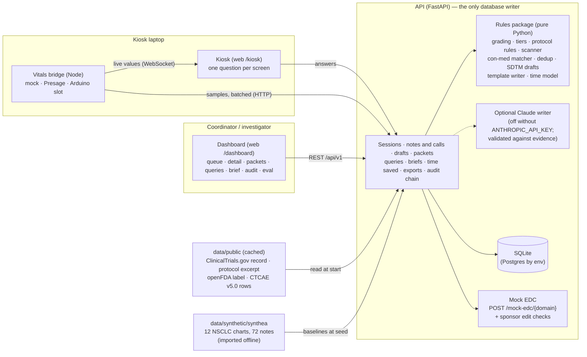

# Interim — the trial coordinator's safety-data desk

**Side effects between visits rarely reach the chart in time. Interim catches them from kiosk check-ins, chart notes and phone calls, and hands the coordinator ready-to-confirm records, 24-hour reports and visit briefs — rules decide, templates write, people confirm.**

HackRU Fall 2026, Regeneron "Best Clinical Trials Solution" track (starter sheet 08, *"How Are You Feeling?"*, in [`site-sheet-08-how-are-you-feeling.md`](site-sheet-08-how-are-you-feeling.md)). MIT licensed. Every participant is synthetic. The demo study is a real, public Regeneron trial record: EMPOWER-Lung 1, cemiplimab (LIBTAYO) in non-small cell lung cancer.

> **Interim is a research data-capture tool. It is not a medical device and does not provide medical advice.** That sentence is the footer of every screen.

---

## The life of one side effect, and the screen that handles each step

A side effect at a trial site goes through eight steps. Interim covers all eight. Success is measured as **coordinator time removed**, not features shipped.

| # | Step | What Interim does | Screen |
|---|---|---|---|
| 1 | The participant feels something between visits | Short check-in in plain words, one question per screen, "in the last 7 days" | **Kiosk** `/kiosk` |
| 2 | It is mentioned somewhere | Three intakes: kiosk check-in; a chart note pasted in (clinic note, urgent-care or ER record); a **phone call** logged by the coordinator. Notes and calls are read by a deterministic scanner that quotes the exact words. | Kiosk · **Notes** `/dashboard/notes` (paste a note, or "Log a call") · participant timeline ("Log a call") |
| 3 | The coordinator has to find it | One queue for every source, sorted by urgency, with a "Since you were last here" summary, 24-hour clock chips (SAE / AESI) and repeat reports merged into the open side effect | **Queue** `/dashboard` · **Escalations** `/dashboard/escalations` |
| 4 | The coordinator types it into the record and the EDC | Records are pre-filled in CDISC SDTM shape (AE, VS, CM); every field links to the answer, note words or rule it came from; confirm, edit (new version) or reject; post to a mock EDC | **Check-in detail** `/dashboard/checkins/:id` · **Note detail** `/dashboard/notes/:id` |
| 5 | Serious or special-interest events need a sponsor report within 24 hours | The 24-hour clock starts when the site becomes aware; a **report packet** is pre-filled from evidence, lists what is still missing, and carries a drafted narrative whose every sentence cites its evidence; follow-up reports show what changed | **Report packet** `/dashboard/packets/:id` |
| 6 | The investigator decides seriousness, causality and whether it is immune-related | Investigator-only controls; signing a packet stops the clock as "reported (mock)"; "Record seriousness decision" for a clock with no side-effect record | Check-in / note detail (attribution box) · Escalations · Report packet (**Sign**) |
| 7 | Sponsor queries come back | Sponsor-side edit checks raise queries on posted records; each query comes with a suggested answer that cites evidence; answer, optionally correcting the field | **Queries** `/dashboard/queries` |
| 8 | Before the next visit, someone briefs the investigator | One printable page per participant: everything since the last visit, open side effects, medication changes with protocol flags, clocks, notes and calls, and questions to ask, each line linked to its evidence | **Visit brief** `/dashboard/participants/:usubjid/brief` |

Around the eight steps: a **time-saved estimate** strip on every dashboard page (`/metrics/time-saved`, with its basis on hover), a **hash-chained audit log** with one-click verify (`/dashboard/audit`), an **Eval** page where anyone can change the input and watch the output change (`/dashboard/eval`), and a hidden **Admin** page (`/admin`).

**How decisions and text are made.** Decisions are rules: grade, urgency tier, who is alerted, whether a 24-hour clock starts, whether a medication goes against the protocol. They live in JSON tables under [`packages/rules/data/`](packages/rules/data/), each with its source and rationale. Generated text (report narratives, visit briefs, suggested query answers) is template-based, and every sentence cites evidence ids that resolve to a stored record. A Claude writer can be switched on with an API key; its text is accepted only if every cited evidence id exists and every quote appears verbatim in the cited source, otherwise the template text is used and the reason is shown. A person reviews every record, report and answer before it leaves the system. Today no key is configured, so everything you see and everything the evaluation measures is the template writer.

**Build status (2026-10-10).** The rules package and the API for all eight steps are complete and tested. The new dashboard screens (packets, brief, queries, call intake, time-saved strip) were built against the contract and are being connected to the live API in the current integration pass; see [`docs/ISSUES.md`](docs/ISSUES.md).

---

## Quickstart

### Docker (what a judge should run)

```bash
git clone https://github.com/omer-khawar/ae-checkin-agent.git interim
cd interim
git checkout interim          # until the pull request is merged into main
docker compose up --build
```

| What | Where |
|---|---|
| Dashboard (log in here) | http://localhost:5173/ |
| Kiosk | http://localhost:5173/kiosk |
| API docs (OpenAPI) | http://localhost:8000/docs |
| Vitals bridge (mock only, every value labeled SIMULATED) | ws://localhost:8787 |

The API seeds the **Monday-morning** demo state on first start (below). `docker compose down -v` wipes the database volume; the next `up` reseeds. All ports bind to `127.0.0.1` by default, because the demo password is public.

### Local development

```bash
cp .env.example .env     # optional; nothing needs editing for the demo
make install             # Python 3.12 venv + editable installs + npm ci (needs Node 20+)
make dev                 # API :8000, web :5173, mock bridge :8787
```

Windows without `make` (Git Bash shown):

```bash
py -3.12 -m venv .venv
.venv/Scripts/python.exe -m pip install -e "packages/rules[dev]" -e "apps/api[dev]"
npm run install:all
npm run dev              # same three processes; the bridge always runs the mock source
```

Other entry points: `make test` (rules, API, scripts, bridge, web), `make lint`, `make eval` (replays every answer key against a throwaway API and rewrites `docs/eval/results.md`; must be 100%), `make demo-reset` (wipe and reseed), `make fetch-public` (refresh the public-data cache). Each has an `npm run` twin in [`package.json`](package.json).

### Demo logins

The login page offers three roles. The shared password is `DEMO_PASSWORD` (default `interim-demo`).

| Role | Can |
|---|---|
| `coordinator` | Read everything; confirm, edit, reject records; acknowledge escalations; prepare report packets and follow-ups; answer queries; log calls; export |
| `investigator` | Everything a coordinator can, plus seriousness (`AESER`), causality (`AEREL`), immune-related (`INTERIM_IRAE`), "Record seriousness decision", and **signing** report packets. Only this role can. |
| `admin` | Everything, plus settings, demo reset, and the sponsor side of queries (raise, close) |

This is a demo authentication model (one shared password, HMAC-signed tokens, roles enforced server-side on every endpoint). Production needs single sign-on with per-user identity in the audit log, revocable sessions and Part 11 electronic signatures; see [Readiness](#readiness).

### What the seed shows (Monday morning)

The seed builds the state the demo story needs, relative to the moment it runs ([`data/synthetic/README.md`](data/synthetic/README.md) §10, asserted exactly by `apps/api/tests/test_admin_seed.py`):

- **Overnight, nothing acknowledged or confirmed yet:** three kiosk check-ins (P-004 routine; P-011 an itchy rash plus **"prednisone" started**, flagged as a discouraged steroid with the protocol's exception text; P-003 diarrhea "almost constantly", a **grade 3 (provisional)** on a potentially immune-related symptom, so a **possible-AESI 24-hour clock** starts), a **caregiver phone call** about P-003's breathing, an **urgent-care record** for P-002 merged into its open rash and itching, and an **ER note** for P-006 (admitted overnight) that starts an **SAE 24-hour clock** with about 21 hours left. Both running clocks already have a pre-filled report packet with a drafted narrative.
- **Last week:** P-012's hospitalization report was signed in time; its packet still lists outcome, action taken and causality as missing, so a **follow-up report is due**.
- **Sponsor queries:** one answered (P-003 loperamide dose), one open (P-005 Zofran, about 72 hours old).
- **Visits:** P-003's previous visit 20 days ago and next visit **tomorrow**, so its visit brief covers everything since.
- **History:** 12 participants (P-001 to P-012) with 35 earlier check-ins and 8 chart notes, each with a background profile from a Synthea synthetic chart, labeled "Synthea synthetic EHR (simulated)".

The three-minute walkthrough of this state is [`docs/DEMO.md`](docs/DEMO.md).

---

## Architecture



| Component | Path | What it is |
|---|---|---|
| Rules package | [`packages/rules`](packages/rules/README.md) | `interim_rules`: PRO-CTCAE composite scoring (Basch 2021), provisional CTCAE grade, red flags, escalation ladder, SAE and AESI clocks, protocol rules (EMPOWER-Lung 1), con-med matcher, de-duplication, SDTM drafting, chart-note scanner, edit checks for sponsor queries, template writer, plain-language labels, time model. Pure functions, every number in a JSON table, `mypy --strict`, branch coverage ≥ 95% |
| API | [`apps/api`](apps/api/README.md) | FastAPI + SQLModel, the system of record: kiosk sessions, notes and calls, drafts and versions, report packets and follow-ups, queries, visit briefs, time-saved metrics, exports and submission bundle, mock EDC, append-only hash-chained audit log, evaluation harness, demo seed |
| Web | [`apps/web`](apps/web/README.md) | React + Vite + TypeScript + Tailwind; kiosk and dashboard in one app |
| Vitals bridge | [`apps/vitals-bridge`](apps/vitals-bridge/README.md) | Node 20 service on the kiosk laptop; source plugins (mock with five scenarios; Presage SmartSpectra; Arduino stub); timing and confidence gates; WebSocket to the kiosk, batched POST to the API. Contract: [`docs/VITALS_SOURCES.md`](docs/VITALS_SOURCES.md) |
| Scripts | [`scripts`](scripts) | `fetch_public.py` (public data, cached, `--offline`), `seed.py`, `run_eval.py`, `synthea/` (reproducible Synthea cohort, importer, independent evaluation) |
| Legacy | [`legacy`](legacy/README.md) | Omer Khawar's original AE Capture Desk, kept for lineage and credit |

---

## Measured vs. simulated

Every number on screen and in every export says where it came from.

| Thing | Status | How it is labeled |
|---|---|---|
| Vitals in the demo (pulse, breathing, HRV) | **Simulated** by the mock source (realistic, autocorrelated signals; five scenarios) | The word **SIMULATED** beside every value; `VSMETHOD = "Simulated"`, `INTERIM_SOURCE = "mock"` in exports. The API refuses a mock sample that claims to be measured. |
| Vitals from the Presage SmartSpectra source | **Measured** by a named camera-based source, when run | **MEASURED**, with source and confidence. Implemented and unit-tested, **not yet run against a live camera** ([`docs/VITALS_SOURCES.md`](docs/VITALS_SOURCES.md) §5). |
| Participants, check-ins, chart notes, phone calls | **Synthetic** | "All participants are synthetic" in the dashboard header |
| Participant background (age, stage, comorbidities, medications, resting pulse and breathing) | **Synthea synthetic EHR (simulated)** | That label, wherever it appears |
| Study record, protocol rules, label excerpt, CTCAE terms | **Real public sources**, cached | "Demo study (public registry record)"; protocol page numbers on every protocol rule |
| Grades | **Provisional** | "(provisional, investigator to confirm)" after every grade |
| Possible AESI | **Suspected by rule** | "possible AESI, investigator to confirm" |
| MedDRA codes | **Mock** | `meddra_code_mock` |
| Medication names | **Bundled list, not RxNorm** | Match confidence and match kind on every CM record |
| Time saved | **Estimate** | "estimate" beside the number, basis on hover |

Vitals are optional context. They never change a grade, they can raise the urgency tier by at most one step under documented rules, and the product works fully with the camera off.

---

## Data sources

| Source | Used for | Link |
|---|---|---|
| ClinicalTrials.gov API v2, **NCT03088540** (EMPOWER-Lung 1, R2810-ONC-1624, Regeneron) | The demo study shown in the dashboard header; cached in `data/public/study.json` | https://clinicaltrials.gov/study/NCT03088540 |
| **EMPOWER-Lung 1 protocol**, Amendment 9 (public PDF on ClinicalTrials.gov) | AESI criteria (§9.4.3, p. 92), 24-hour SAE reporting (§9.4.2, p. 91), AE reporting window (§9.4.1, p. 91), prohibited / discouraged / permitted medications and CM form fields (§7.7, p. 69). Verbatim excerpt with page numbers and sha256 in `data/public/empower_lung1_protocol_excerpt.json` | https://cdn.clinicaltrials.gov/large-docs/40/NCT03088540/Prot_000.pdf |
| **openFDA** drug label API | LIBTAYO adverse-reactions excerpt (reference in the investigator panel); the 300-name medication list (not RxNorm) | https://open.fda.gov/apis/drug/label/ |
| **NCI CTCAE v5.0** | Standard term names and grade text for the 10 symptoms (10 rows extracted) | https://evs.nci.nih.gov/ftp1/CTCAE/CTCAE_5.0/ |
| **NCI PRO-CTCAE** | Structure of the 10 check-in items (frequency / severity / interference, 7-day recall). Our wording is modeled on it, not the licensed items. | https://healthcaredelivery.cancer.gov/pro-ctcae/ |
| **Basch et al. 2021**, PRO-CTCAE composite grading algorithm, *Clin Trials* 18(1):104–114 | Composite scoring tables, reproduced verbatim | https://doi.org/10.1177/1740774520975120 |
| **Synthea** (MITRE), pinned build, fixed seeds | 12 synthetic NSCLC charts and 72 notes: participant backgrounds and an independent test of the scanner and medication matcher | https://github.com/synthetichealth/synthea |
| CDISC SDTM Implementation Guide | AE / VS / CM variable names | https://www.cdisc.org/standards/foundational/sdtmig |
| Time model sources (Mednet via Clinical Trial Vanguard; MSK + IgniteData) | The time-saved estimate: 12–15 h per study per week copying EHR data into the EDC (context only), and one measured per-field entry rate (the anchor). All other per-field minutes are labeled assumptions. | https://www.clinicaltrialvanguard.com/?p=32325 · https://www.mskcc.org/announcements/msk-presents-significant-data-study-findings-to-fda |

Public data is fetched only by `scripts/fetch_public.py` and committed, so the demo works offline. Nothing is fetched at runtime.

---

## Evaluation

Two generated reports, both reproducible from a clean clone (`make eval`; `python scripts/synthea/eval_synthea.py --check`):

**[`docs/eval/results.md`](docs/eval/results.md)** replays every answer key through the running API over HTTP:
- **36 / 36 check-in personas pass** (31 shipped, including 7 protocol personas, plus 5 hidden "judge" personas). Tier precision and recall are 1.00 for all four tiers; the provisional-grade confusion matrix is diagonal.
- **3 / 3 counterfactuals pass**: same answers, one setting changed; the tier moves and no grade does.
- **Chart-note scanner: 38 / 38 fully scorable answer-key cases exact** (plus 1 partially scorable case exact on everything observable), and **8 / 8 notes** pass through the real `/notes` endpoint, including the cross-source follow-up links.

These are regression tests: the answer keys were written alongside the rules, so 100% means "the rules do what the tables say", not "the rules are clinically right".

**[`docs/eval/synthea_results.md`](docs/eval/synthea_results.md)** is the independent test, on Synthea text the scanner was never tuned on (synthetic data, not a clinical validation):
- Symptoms: precision **0.919**, recall **0.792** (0.950 on concepts the lexicon names).
- Medications named in the note text: precision **1.000**, recall **0.178**.
- Over-escalation: **55.8%** of routine ambulatory notes raise a red flag (a templated "chest pain" complaint); seriousness recall from text **0 / 27**, because Synthea records hospital stays as structured data, not words.

The weak numbers are the point of running it. They are explained in [`docs/WHAT_IT_GETS_WRONG.md`](docs/WHAT_IT_GETS_WRONG.md) §15 and §18.

---

## Readiness

| Item | Where |
|---|---|
| Runs from a clean clone with `docker compose up --build`, and with `make dev` / `npm run dev` | [`docker-compose.yml`](docker-compose.yml), [`Makefile`](Makefile), [`package.json`](package.json) |
| Multi-stage Docker images for API and web; mock-only bridge image | `apps/*/Dockerfile` |
| CI on every push and pull request: ruff, mypy `--strict`, pytest (rules with a 95% branch-coverage gate, API, scripts), eslint + `tsc` + tests (web, bridge), offline public-data check, Synthea reproducibility check, deterministic eval, Docker build | [`.github/workflows/ci.yml`](.github/workflows/ci.yml) |
| Configuration only through environment variables; every variable documented; no secrets in the repo | [`.env.example`](.env.example) |
| SQLite in a volume by default; Postgres by changing `DATABASE_URL` | `apps/api/README.md` |
| Health endpoint for probes: `GET /api/v1/health` | `apps/api` |
| Roles enforced server-side on every endpoint; only the investigator signs reports and records seriousness and causality | `apps/api/README.md` "Auth model" |
| Append-only, hash-chained audit log; `GET /audit/verify` names the first broken link | `apps/api/README.md` "Audit chain" |
| No telemetry, no third-party scripts, no network calls at runtime (one documented exception: the optional Presage SDK validates its key with the vendor) | `docs/PRD.md` §10 |
| MIT license | [`LICENSE`](LICENSE) |

**What production would need:** single sign-on (OIDC/SAML) with per-user identity in every audit event; 21 CFR Part 11 electronic signatures for signing and attribution; token revocation and MFA; a secrets manager for `AUTH_SECRET` and `BRIDGE_TOKEN`; Postgres; TLS; a validation package for the rule tables; a real EDC and safety-database connector in place of the mock EDC; licensed PRO-CTCAE items, MedDRA and RxNorm. [`docs/PRD.md`](docs/PRD.md) §10–11 lists each.

---

## Documentation

| Document | What it is |
|---|---|
| [`docs/PRD.md`](docs/PRD.md) | Product requirements: the coordinator's workload, the 8 steps, user stories, success metrics, Good/Better/Best mapping |
| [`docs/DEMO.md`](docs/DEMO.md) | The 3-minute Monday-morning demo script, with exact clicks |
| [`docs/SLIDES.md`](docs/SLIDES.md) | 12-slide deck outline with speaker notes |
| [`docs/WHAT_IT_GETS_WRONG.md`](docs/WHAT_IT_GETS_WRONG.md) | Honest limitations, each with a reproducible example |
| [`docs/NOT_BUILT.md`](docs/NOT_BUILT.md) | What we deliberately did not build, and why |
| [`docs/DECISIONS.md`](docs/DECISIONS.md) | Decision log (D-001 onward; D-023 to D-026 for the expanded scope) |
| [`docs/ISSUES.md`](docs/ISSUES.md) | Issue tracker |
| [`docs/CONTRACTS.md`](docs/CONTRACTS.md) | Interface contracts between rules, API, bridge and web (Revisions 2–4 win on conflict) |
| [`docs/VITALS_SOURCES.md`](docs/VITALS_SOURCES.md) | Vitals adapter contract, mock source, Presage source, Arduino slot |
| [`data/synthetic/README.md`](data/synthetic/README.md) | How the synthetic participants, notes and Monday-morning state are generated |
| [`docs/screenshots/`](docs/screenshots/README.md) | Screenshots (captured before the stage-2 screens; the kiosk consent screen shown there has since been removed) |
| [`CLAUDE.md`](CLAUDE.md) | The build brief (read §00 first) |

**What it gets wrong.** The composite-to-grade crosswalk is our approximation, not a validated instrument; the scanner finds only what its lexicon names and over-flags templated text; the template writer reads stiffly and cannot infer missing facts; the time-saved number is an estimate built mostly on assumptions; and the Presage source has never seen a live camera. The full list, with examples you can reproduce: [`docs/WHAT_IT_GETS_WRONG.md`](docs/WHAT_IT_GETS_WRONG.md).

---

## Credits

- **Omer Khawar**, *AE Capture Desk* (the original repository, MIT): the deterministic chart-note scanner and its answer key, and the Presage SmartSpectra groundwork, ported into Interim with credit. His original build is preserved in [`legacy/`](legacy/README.md) ([`docs/DECISIONS.md`](docs/DECISIONS.md) D-014).
- **Synthea**, © The MITRE Corporation, Apache-2.0: synthetic patient generator (Walonoski et al., *JAMIA* 2018, https://doi.org/10.1093/jamia/ocx079).
- **Presage Technologies**, SmartSpectra SDK: the camera-based vitals source (`@smartspectra/node-sdk`, an optional install, never bundled). https://physiology.presagetech.com
- NCI (PRO-CTCAE, CTCAE), Basch et al. (composite grading), ClinicalTrials.gov, openFDA, CDISC, and Regeneron's starter sheet.

## License

MIT. See [`LICENSE`](LICENSE).
