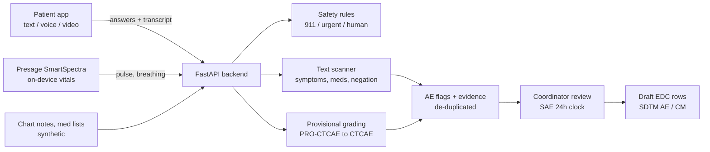

# AE Capture Desk

**A between-visit check-in agent that captures adverse events (AEs) and medication changes from clinical-trial patients and delivers a reviewed, evidence-backed summary to the research team.**

Built at HackRU 2026 for the **Regeneron** challenge, starter sheet 08: *"How Are You Feeling?"*

> Synthetic data only. Not a medical device. The agent never gives medical advice, and the investigator decides seriousness and attribution.

---

## The problem

Between trial visits, patients feel side effects and start or stop other medicines. Most of it surfaces weeks later, from memory, at the next visit. Notes mention problems that never reach the EDC. Urgent symptoms reported casually don't get escalated. NCI built [PRO-CTCAE](https://healthcaredelivery.cancer.gov/pro-ctcae/) because clinician-only reporting under-detects symptomatic AEs.

## What this does

| Input | What happens | Output for the coordinator |
|---|---|---|
| **Check-in** (text, voice, or video) using PRO-CTCAE-style questions | Branching question flow, spoken answers parsed ("pretty bad" → Severe), live safety checks on every answer | Structured symptom report + provisional CTCAE grade with the reasoning written out |
| **Presage SmartSpectra** camera vitals (pulse, breathing rate, HRV) | Summarized, compared to the patient's own baseline | Objective evidence attached to related AE flags (e.g. reported shortness of breath + breathing rate up 12/min) |
| **Chart notes / med lists** | Scanned for symptoms and med changes, with negation ("denies fever"), history ("hx of migraines") and patient-education text ("call for fever > 100.4") filtered out | Possible-AE flags and con-med changes, each with the exact quote |
| All of the above | **De-duplicated across sources**: the same AE from a check-in and a note becomes one flag with several pieces of evidence | Review queue, sorted serious-first |
| Anything urgent | Emergency → patient told to call 911 immediately. Urgent → nurse alerted. "Talk to a person" → human requested | Escalation list |
| ER visit / hospitalization | **Serious-AE clock** starts when the site becomes aware (24h default) | Countdown on the dashboard |
| Confirmed flags | Investigator sets seriousness and attribution | **Draft EDC rows** in CDISC SDTM AE / CM shape |

This covers the starter sheet's **Good → Better → Best** tiers on the backend (multilingual voice and the UI are up to the app).



## Repo layout

```
backend/          FastAPI + SQLite API (this is what the app talks to)
  app/
    main.py         app, CORS, startup seeding
    models.py       database tables
    routers/        HTTP endpoints
    services/       the logic: items, grading, safety, extract (scanner), vitals, capture, edc
    data/           synthetic personas, chart notes, answer key
  scripts/evaluate.py   precision / recall against the answer key
  tests/            end-to-end API tests
presage-bridge/   Node script: Presage SmartSpectra on a laptop webcam -> backend
frontend/         the app (patient check-in + coordinator desk)
render.yaml       one-click deploy on Render
AGENTS.md         context + rules for AI coding agents (CLAUDE.md points to it)
```

---

## Run it locally (about 3 minutes)

Needs **Python 3.10+** (3.11 or 3.12 recommended). No Python on Windows? `winget install -e --id Python.Python.3.12`, then open a new terminal.

**Windows, easiest:** double-click `backend\start-backend.bat`. It finds Python (or installs 3.12 with winget), creates the virtual environment, installs everything, starts the server and opens the docs.

**Windows (PowerShell, manual)**
```powershell
cd backend
python -m venv .venv                 # or: py -m venv .venv
.venv\Scripts\Activate.ps1          # if blocked: Set-ExecutionPolicy -Scope CurrentUser RemoteSigned
pip install -r requirements.txt
uvicorn app.main:app --reload
```

**macOS / Linux**
```bash
cd backend
python3 -m venv .venv
source .venv/bin/activate
pip install -r requirements.txt
uvicorn app.main:app --reload
```

Open **http://localhost:8000/docs** for interactive API docs. On first start the database is created and loaded with 7 synthetic patients, 8 chart notes and 6 completed check-ins, so every screen has something to show.

```bash
pytest                       # 17 end-to-end tests
python -m scripts.evaluate   # precision / recall against the answer key
python -m app.seed --reset   # wipe and reload the demo data
```

Settings live in `backend/.env` (copy `.env.example`). All are optional.

---

## For the app developer

Base URL: `http://localhost:8000` locally, or your deployed URL. CORS is open. Every endpoint is documented with request/response shapes at `/docs`.

### The check-in loop

```js
const API = "http://localhost:8000";
const post = (path, body) =>
  fetch(API + path, { method: "POST", headers: { "Content-Type": "application/json" }, body: JSON.stringify(body) })
    .then(r => r.json());

// 1. Start. Read opening_script aloud / show it first (it says the agent is automated, offers a human, mentions 911).
let { checkin, opening_script, next_question } = await post("/api/checkins", { patient_id: 1, mode: "voice" });

// 2. Ask each question; send the option index OR what they said (it gets parsed).
while (next_question) {
  const said = await askUser(next_question);                 // your UI / speech-to-text
  const r = await post(`/api/checkins/${checkin.id}/answers`, {
    answers: [{ question_id: next_question.id, text: said }]  // or { value: 2 }
  });
  if (r.patient_message) await sayToUser(r.patient_message); // safety message, say it verbatim
  if (r.end_checkin) break;                                   // emergency: they were told to call 911
  // r.needs_details -> ask r.needs_details[0].prompt and send it as text for the same question_id
  next_question = r.next_question;                            // same question again if the answer wasn't understood
}

// 3. (Optional) Presage vitals for video check-ins: see presage-bridge/ or POST raw Metrics yourself
await post(`/api/checkins/${checkin.id}/vitals`, { metrics: presageMetricsArray });

// 4. Finish -> structured report (flags with evidence, con-med changes, escalations, closing_message)
const report = await post(`/api/checkins/${checkin.id}/complete`, {});
```

### Endpoints

| Method | Path | What it's for |
|---|---|---|
| GET | `/health` | Liveness check |
| GET | `/api/items` | The question set and answer scales |
| POST | `/api/scan` | Dry-run the text scanner on any text (nothing saved), useful for demos |
| GET / POST | `/api/patients` | List / create patients |
| GET | `/api/patients/{id}/summary` | Everything for one patient: flags + evidence, con-meds, escalations, vitals trend |
| GET | `/api/patients/{id}/edc-draft` | Draft SDTM-style AE and CM rows |
| POST | `/api/patients/{id}/vitals` | Presage vitals outside a check-in |
| POST | `/api/checkins` | Start a check-in (voice/video blocked if the patient didn't consent) |
| POST | `/api/checkins/{id}/answers` | Submit answers, get live safety result + next question |
| POST | `/api/checkins/{id}/transcript` | Free-form speech/text (red flags handled immediately) |
| POST | `/api/checkins/{id}/vitals` | Attach Presage vitals |
| POST | `/api/checkins/{id}/complete` | Grade, scan, merge, escalate → report |
| GET | `/api/checkins/{id}` | The report (also works mid-check-in) |
| POST | `/api/notes` | Ingest a chart note → findings with evidence |
| GET / PATCH | `/api/flags`, `/api/flags/{id}` | Review queue; confirm/reject, final grade, seriousness, attribution |
| GET / PATCH | `/api/conmeds`, `/api/conmeds/{id}` | Con-med changes to confirm |
| GET / PATCH | `/api/escalations`, `/api/escalations/{id}` | Open escalations, most urgent first; acknowledge/resolve |
| GET | `/api/dashboard` | Site counts + running SAE clocks |

Demo patients: **1** Maria (mild nausea), **2** James (rash), **3** Linda (worsening shortness of breath + Presage vitals, urgent), **4** Robert (antibiotic from urgent care), **5** Aisha (unsure if headaches "count"), **6** Daniel (caregiver answering, then an ED visit, SAE clock running), **7** Kevin (no consent for automated calls, use him for a fresh live demo by text).

---

## Presage SmartSpectra

SmartSpectra measures pulse, breathing rate and HRV from a camera. It runs **on the device** (iOS, Android, C++, Node/Electron SDKs) and has no cloud endpoint for measurements, so:

- **Native mobile app:** use the iOS/Android SDK and POST the decoded `Metrics` (or a summary) to `/api/checkins/{id}/vitals`.
- **Web app / laptop demo:** run `presage-bridge/`, which uses the official Node SDK on the laptop webcam and forwards to the backend. The web app can trigger it with `POST http://localhost:8787/measure {"checkin_id": 12}`.

```bash
cd presage-bridge
npm install
cp .env.example .env          # add PRESAGE_API_KEY from https://physiology.presagetech.com
node bridge.js measure --checkin 12               # real webcam measurement
node bridge.js measure --checkin 12 --demo        # simulated, no camera or key needed
node bridge.js serve                              # HTTP trigger for a web frontend
```

The backend accepts `Metrics` JSON in snake_case or camelCase (what the Node SDK's protobuf `toObject` produces), keeps samples above Presage's own stability thresholds (pulse confidence ≥ 40, breathing ≥ 45), and takes the median. **Vitals never create an AE or an emergency on their own.** They are attached as supporting evidence to symptoms the patient reported, and can raise an existing shortness-of-breath flag to an urgent escalation.

## Safety rules (from the starter sheet), and where they're enforced

| Rule | Implementation |
|---|---|
| Say it's automated at the start of every call | `opening_script` returned by `POST /api/checkins` |
| Offer a human at any point | "talk to a person / real person / representative" in any answer → `human_requested` escalation |
| Never give medical advice | Patient-facing messages are fixed scripts in `services/safety.py`; no generated advice |
| Send emergencies to 911 immediately | Chest pain, can't breathe, fainting, seizure, throat swelling, stroke signs, coughing/vomiting blood, self-harm (also 988) → `end_checkin: true` + 911 message on that answer |
| Call only people who consented | Voice/video check-ins return 403 if `consented_to_contact` is false |
| Investigator decides seriousness and attribution | System only marks *possible* SAEs; `serious` and `attribution` are set via `PATCH /api/flags/{id}` |

## How the outputs explain themselves

Every flag carries its evidence: the source (check-in answer, check-in text, chart note, vitals), the exact quote with character offsets, and a written reason, e.g. *"Text mentions 'SOB' → CTCAE term 'Dyspnea'. Described as worsening."* or *"15% BSA → CTCAE v5 maculo-papular rash grade 2 (<10% G1, 10–30% G2, >30% G3)."* Mentions that were skipped are returned too (`excluded_symptoms`, with `negated` / `historical` / `hypothetical`), so a reviewer can see what the scanner chose to ignore.

Grades are **provisional**. Structured answers use a transparent PRO-CTCAE → CTCAE heuristic (written out per flag). It is *not* the validated PRO-CTCAE composite grading algorithm (Basch et al., *Clinical Trials* 2021), which would be the next step.

## Evaluation

`python -m scripts.evaluate` scores the text scanner against `backend/app/data/answer_key.json` (8 synthetic chart notes + 17 check-in utterances, including traps like "I'm confused about whether this counts", "I can't stop coughing", "denies nausea, vomiting, or diarrhea", Celsius fevers, brand names).

Current result: AE terms P = R = 1.00, con-meds P = R = 1.00, **11/11 urgent-or-emergency cases escalated, 2/2 emergencies, 0 over-escalations.**

Be honest about what that means: the answer key was written alongside the rules, so it's a regression test, not an accuracy estimate. Before quoting numbers to judges, have a teammate write 15–20 new cases cold (without looking at `extract.py`) and report that score.

## Data sources

| Source | Used for |
|---|---|
| [NCI PRO-CTCAE item library](https://healthcaredelivery.cancer.gov/pro-ctcae/) | Question wording, attributes and 5-point scales (10 of the 78 symptom terms) |
| [NCI CTCAE v5](https://evs.nci.nih.gov/ftp1/CTCAE/) | AE term names; grading thresholds for diarrhea (stools/day) and maculo-papular rash (% BSA) |
| [CDISC SDTM/ADaM pilot project](https://github.com/cdisc-org/sdtm-adam-pilot-project) | AE / CM output variable names (AETERM, AEDECOD, AETOXGR, AESER, AEREL, CMTRT, CMDECOD...) |
| [Presage SmartSpectra docs](https://smartspectra.presagetech.com/docs/data-types/) | Vitals message format, confidence thresholds, validity ranges |
| [irAE-Agent field guide (arXiv 2509.26153)](https://arxiv.org/pdf/2509.26153) | Design inspiration: evidence-first chart review, human in the loop |
| Synthetic (written for this project) | 7 patient personas, 8 chart notes, check-in answers, simulated Presage samples, answer key. All documented in `backend/app/data/`. [Synthea](https://github.com/synthetichealth/synthea) can generate more notes/med lists |

## Deploy

**Render (free):** push to GitHub → Render → New + → Blueprint → pick the repo. It reads `render.yaml`. The demo data re-seeds on each deploy.

**Docker (anywhere):**
```bash
cd backend
docker build -t ae-capture-api .
docker run -p 8000:8000 ae-capture-api
```

For a phone app hitting your laptop during the demo, run `uvicorn app.main:app --host 0.0.0.0 --port 8000` and use the laptop's LAN IP. Hackathon Wi-Fi often blocks device-to-device traffic, so a deployed URL is safer.

## Limitations / next steps

- Rule-based scanner: transparent and offline, but it only knows the terms in its lexicon. An LLM extractor could slot in behind `scan_text()` with the same evidence-span output, scored by the same answer key.
- No authentication. Fine for synthetic demo data, required before anything real.
- MedDRA coding isn't included (licensed); CTCAE terms stand in for AEDECOD.
- English only for now.

## License

MIT, see [LICENSE](LICENSE).
